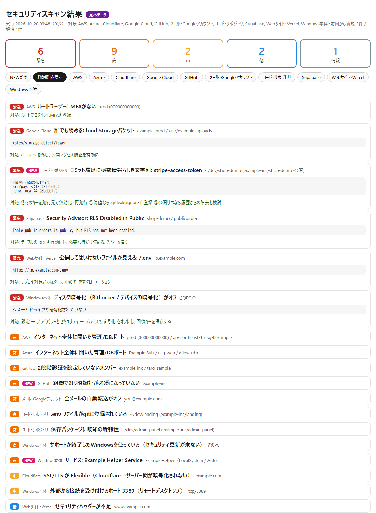

# claude-security-scan（Windows版）

**「セキュリティチェックして」の一言で、自分の開発環境をまるごと点検する Claude Code スキルの Windows 版。**

Windows 本体・手元の全gitリポジトリ・GitHub・Vercelと公開サイト・クラウド（AWS / Google Cloud / Azure / Cloudflare / Supabase）・Gmail を**読み取り専用**で横断スキャンし、
重要度別のレポートと「前回から増えたもの」を出します。設定の書き換え・送信・削除は一切しません。

> 元のプロジェクト: [chaenmasahiro0425/claude-security-scan](https://github.com/chaenmasahiro0425/claude-security-scan)（Masahiro Chaen 氏・MIT License・macOS 向け）。
> このリポジトリはそれを Windows 向けに改変したものです。変更点は [NOTICE.md](NOTICE.md) を参照してください。



## なぜ作ったか

最近の情報漏えいは、高度な攻撃より「うっかり」から起きています。

- コミット履歴に残ったままのAPIキー
- 本番に一緒に上がってしまった `.env`
- MFAの無いクラウドの管理者アカウント
- 2段階認証を必須にしていない GitHub の組織
- 乗っ取られたメールに仕込まれた自動転送
- 暗号化されていないノートPC、止まったままの Windows Update、OneDrive に同期された `.env`

どれも、見に行けば数秒で分かります。ただ、確認する場所が散らばっていて、毎週全部を見て回る人はいません。
それを Claude Code に任せるためのスキルです。

## 何を見るか

| 領域 | 主なチェック |
|---|---|
| Windows本体 | サポート期限（Windows 10 / 11 の各版）・BitLocker / デバイスの暗号化・ファイアウォール（全プロファイル）・Microsoft Defender（リアルタイム保護・定義ファイル・改ざん防止・広すぎる除外）・UAC・SmartScreen・セキュアブート・メモリ整合性・自動ログインと平文パスワード・画面ロック／スリープ復帰時のサインイン・リモートデスクトップ（NLA）・SMBv1・Guest / Administrator・管理者グループ・未適用の Windows Update・外から接続できるポート・共有フォルダ・SSH秘密鍵や認証情報ファイルの ACL・`.git-credentials`・自動起動（Run キー・スタートアップ・タスクスケジューラ・サービス。SYSTEM 権限の常駐が書き換え可能／未署名のファイルを起動していないか、一時フォルダからの起動や難読化された PowerShell がないか） |
| コード | 手元の全gitリポジトリのコミット履歴にある秘密情報（[gitleaks](https://github.com/gitleaks/gitleaks)・値は伏せ字）・`.env` のgit登録・依存パッケージの既知脆弱性（内蔵の [OSV.dev](https://osv.dev) 検査。設定で [osv-scanner](https://github.com/google/osv-scanner) も選べる）・OneDrive 等の同期フォルダ内のリポジトリ（除外したはずの `.env` がクラウドへ上がる） |
| GitHub | 本人と所属組織の2FA・2FA必須設定・未設定のメンバー・公開リポ作成権限・外部コラボレーター・Webhook・Dependabot / Secret scanning のアラート |
| Webサイト・Vercel | 全チームの本番ドメイン: HTTPS・証明書期限・セキュリティヘッダー・`.env` / `.git` の露出・プレビューURLの保護・ブラウザに出てしまう秘密っぽい環境変数 |
| AWS | ルートのMFA・MFAの無いIAMユーザー・放置されたアクセスキー・公開S3・CloudTrail・GuardDuty・全開放の管理/DBポート・公開RDS |
| Google Cloud | allUsers に付いた権限・個人Gmailへのオーナー権限・サービスアカウントの鍵・公開バケット・全開放のファイアウォール・全開放のCloud SQL |
| Azure | 匿名公開を許すストレージ・HTTPを受け付けるストレージ・全開放のNSG（管理/DBポート）・全開放のAzure SQL・Defender for Cloud |
| Cloudflare | SSL/TLSのモード（Off / Flexible）・Always Use HTTPS・最小TLS・DNSSEC・2段階認証の無いメンバー |
| Supabase | 公式 Security Advisor の診断（RLSの無い公開テーブル・security definer のビュー など） |
| Gmail | 自動転送・転送フィルタ・警告メールを隠すフィルタ・委任・最近のセキュリティ通知（件名だけ） |

入っているCLIと、設定したAPIトークン（Cloudflare・Supabase）だけを使います。無いものは「確認できなかった項目」に理由つきで出るだけで、止まりません。
**「確認できなかった」を「問題なし」と混同しない**のがこのツールの方針です。
Windows 本体の検査は**管理者権限なし**で動きます（管理者でないと読めない項目は「確認できなかった」に出ます）。

## 導入

PowerShell で:

```powershell
git clone https://github.com/gabachom/claude-security-scan-windows "$env:USERPROFILE\.claude\skills\security-scan"
powershell -ExecutionPolicy Bypass -File "$env:USERPROFILE\.claude\skills\security-scan\scripts\install-tools.ps1"   # gitleaks を取得（SHA256を検証）
```

あとは Claude Code で **「セキュリティチェックして」** と言うだけです。

必要なもの: Windows 10 / 11、[Python 3.11 以上](https://www.python.org/downloads/windows/)（`py` ランチャー付き。Microsoft Store のエイリアスではなく python.org 版を推奨）、Git for Windows。
各領域を見るには、それぞれのCLIにログインしておきます（入っているものだけでOK）。

| 領域 | 準備 |
|---|---|
| GitHub | `winget install GitHub.cli` → `gh auth login` |
| Vercel | `npm i -g vercel` → `vercel login` |
| AWS | `winget install Amazon.AWSCLI` → `aws configure` または `aws sso login` |
| Google Cloud | `winget install Google.CloudSDK` → `gcloud auth login`（閲覧者 roles/viewer 相当の権限） |
| Azure | `winget install Microsoft.AzureCLI` → `az login`（閲覧者 Reader 相当の権限） |
| Cloudflare | 読み取り専用のAPIトークンをユーザー環境変数 `CLOUDFLARE_API_TOKEN` に設定 |
| Supabase | `supabase login`。RLSなどの診断はユーザー環境変数 `SUPABASE_ACCESS_TOKEN` を設定 |
| Gmail | [gog](https://github.com/steipete/gogcli) で `gog auth add you@example.com` |

ユーザー環境変数は「設定 → システム → バージョン情報 → システムの詳細設定 → 環境変数」、または PowerShell で
`[Environment]::SetEnvironmentVariable('CLOUDFLARE_API_TOKEN', '<値>', 'User')` で設定します（ターミナルの開き直しが必要）。

## 使い方

Claude Code から:

> セキュリティチェックして
> 前回から新しく出たリスクだけ教えて
> 直せるところある？
> 毎週月曜にスキャンするようにして

PowerShell から:

```powershell
$S = "$env:USERPROFILE\.claude\skills\security-scan"
py -3 "$S\scan.py"                       # 全部
py -3 "$S\scan.py" --skip repos          # 重いコード検査を外す
py -3 "$S\scan.py" --only windows --open # Windows 本体だけ見て、終わったらブラウザで開く
py -3 "$S\scan.py" --demo --open         # 見本データで見た目だけ確認
powershell -ExecutionPolicy Bypass -File "$S\scripts\install-schedule.ps1"   # 毎週月曜 8:00 に自動実行（タスクスケジューラ）
```

`bin\security-scan.cmd` を PATH に通せば `security-scan --skip repos` のようにも呼べます。

結果は `reports\<日時>\report.html`（重要度・領域・NEWだけで絞り込み）に保存され、最新の結果は `reports\latest\` にコピーされます。

## 安全のための作り

- **読み取りだけ**: Windows はレジストリの読み取りと PowerShell の `Get-*` 系だけ、gog は `--readonly`、各クラウドは list / get / describe と API の GET だけ、Webサイトへも GET だけ
- **外へ送るのは最小限**: 内蔵の依存検査が OSV.dev へ送るのはパッケージ名・バージョン・エコシステム名だけ（コードやパスは送らない。osv-scanner と同じ問い合わせ先）
- **秘密の値を残さない**: gitleaks は `--redact`、Vercelの環境変数は名前と種類だけ、AWSのキーIDは末尾4桁、自動起動・タスク・サービスの起動引数は記録しない（危険な書き方かどうかの判定にだけ使う）、レジストリの平文パスワードは「有無」だけ。エラー文も伏せ字にしてから保存
- **外から来た文字列をコードとして実行しない**: PowerShell へはスクリプトを `-EncodedCommand` で渡し、パス等のデータは環境変数の JSON で渡す。`gcloud.cmd` / `az.cmd` などのバッチ経由の CLI には、cmd.exe が解釈する文字を含む引数を渡さない
- **見えなかったものを「解消」にしない**: 取得に失敗した範囲（アカウント・組織・リポジトリ単位）の指摘は、前回との比較で「解消」にも「新規」にも数えない
- レポートは自分のPCにだけ保存し、`reports` フォルダは本人と SYSTEM だけが読める ACL にする。弱点の一覧なので共有に注意してください。OneDrive 等の同期フォルダ内に置いている場合は警告します（環境変数 `SECURITY_SCAN_REPORTS` で保存先を変えられます）

## 設定（任意）

無くても動きます。対象を絞りたいときだけ [`config.example.toml`](config.example.toml) を
`%USERPROFILE%\.config\security-scan\config.toml` にコピーして編集してください。

## 制限

- 管理者権限でしか読めない項目（Defender の除外一覧・共有フォルダの一覧など）は、通常の実行では「確認できなかった項目」に出ます
- Windows 10 の ESU（延長セキュリティ更新）の加入状況は判定できません。加入済みならサポート終了の指摘は無視してください
- Google Workspace 全体の管理設定（社員の2段階認証の強制など）は Admin API の委任が必要なため対象外です
- AWS のリージョン単位の検査（セキュリティグループ・RDS・GuardDuty）は、既定で東京（ap-northeast-1）とバージニア（us-east-1）だけです。ほかのリージョンを使っている場合は設定の `[aws] regions` に足してください
- 外部サイトへの攻撃的な検査（総当たり・ファジング）はしません。自分が管理するサイトだけを対象にしてください
- 検出は手がかりです。最終判断と修正は人が行ってください

## つまずき

- 依存パッケージの検査は既定で内蔵版です（Python だけで動き、ロックファイルのパッケージ名とバージョンを OSV.dev の公開APIに問い合わせる。追加の exe 不要）。
  osv-scanner を使いたい場合は `install-tools.ps1 -WithOsvScanner` で入れ、設定に `osv_engine = "osv-scanner"` を書きます（未署名の exe なのでウイルス対策ソフトに止められることがあります）。
  内蔵版が読むファイル: `package-lock.json` / `pnpm-lock.yaml` / `yarn.lock` / `requirements*.txt`（`==` で固定したもの）/ `poetry.lock` / `Pipfile.lock` / `uv.lock` / `pdm.lock` / `Cargo.lock` / `go.mod` / `Gemfile.lock` / `composer.lock`
- `gitleaks.exe` が起動しない → `bin` フォルダをウイルス対策ソフトの除外に入れるか、`winget install Gitleaks.Gitleaks` で入れ直してください（PATH 上のものを使います）
- `py` が見つからない → python.org のインストーラーで「py launcher」を有効にして入れ直す
- タスクスケジューラから実行したときに通知が出ない → 設定 → システム → 通知 で「Windows PowerShell」の通知を許可する

## 改善・追加を歓迎します

「この検査は誤検知が多い」「こういう漏えいの入口も見たい」など、Issue・Pull Request で気軽に提案してください。手順は [CONTRIBUTING.md](CONTRIBUTING.md) にあります。
macOS 版の改善は[元のリポジトリ](https://github.com/chaenmasahiro0425/claude-security-scan)へどうぞ。

## ライセンス

MIT（[LICENSE](LICENSE)）。元の作者 Masahiro Chaen 氏の著作権表示を含みます。
